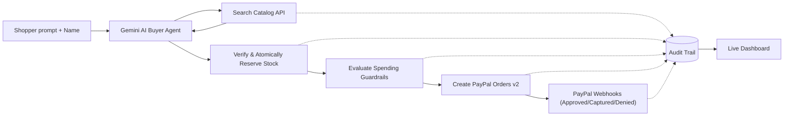

# Agentic Commerce — Studio Loom (PayPal AI Hackathon)

Studio Loom is an autonomous, agent-ready commerce storefront built for the **PayPal AI Hackathon**. A shopper expresses what they want in conversational natural language; a Gemini-powered AI buyer agent parses the shopper's intent, queries the catalog, selects the best matching item with explainable reasoning, verifies stock atomically, applies spending guardrails, and issues a **PayPal Checkout Order**. Every step is documented in an immutable audit trail.

[](LICENSE)

---

## Why Agentic Commerce Needs Guardrails

Agentic commerce demands more than a simple search interface. Studio Loom makes the end-to-end purchasing path safe, auditable, and resilient:

- **Agent-Readable Catalog:** Standardized schema exposing product specifications, live stock levels, and merchant attribution.
- **Atomic Stock Reservation:** Optimistic database locks that guarantee concurrent agent requests cannot oversell limited inventory.
- **Autonomous Spending Guardrails:** Configurable rules (e.g., maximum transaction limits and human-in-the-loop approval gates) before any payment order is generated.
- **Resilient PayPal Integration:** OAuth 2.0 client credential caching, PayPal Orders v2 API with auto-retry, webhook verification, and automated inventory release upon payment cancellation or denial.
- **Explainable Audit Trail:** Full chronological log showing AI reasoning, inventory actions, gatekeeper decisions, and payment events.

---

## Architecture Flow



---

## Tech Stack

- **Frontend:** React 18, TypeScript, Vite, Tailwind CSS
- **Backend:** Node.js, Express, TypeScript, Mongoose, MongoDB Atlas
- **AI / LLM:** Google Gemini structured JSON output (`gemini-2.5-flash` / `gemini-1.5-flash`)
- **Payments:** PayPal Developer Platform (Sandbox Orders v2 REST API & Webhooks)

---

## Local Setup & Quickstart

### 1. Clone & Install
```bash
git clone <your-repo-url>
cd agentic-catalog
npm install
```

### 2. Configure Environment Variables
Create `server/.env`:
```env
PORT=5000
NODE_ENV=development
CLIENT_URL=http://localhost:5173

MONGODB_URI=mongodb+srv://<user>:<pass>@cluster.mongodb.net/agentic-catalog-paypal?retryWrites=true&w=majority

# PayPal Sandbox (from developer.paypal.com > Apps & Credentials)
PAYPAL_CLIENT_ID=your_sandbox_client_id
PAYPAL_CLIENT_SECRET=your_sandbox_client_secret
PAYPAL_ENVIRONMENT=sandbox
PAYPAL_WEBHOOK_ID=your_webhook_id

# AI Agent (Google Gemini)
LLM_API_KEY=your_gemini_api_key
LLM_PROVIDER=gemini
LLM_MODEL=gemini-2.5-flash

# Guardrails (in USD)
MAX_ORDER_VALUE=500
APPROVAL_THRESHOLD=100
```

Create `client/.env`:
```env
VITE_API_BASE_URL=http://localhost:5000/api
```

### 3. Seed Catalog
```bash
npm run seed
```

### 4. Run Development Servers
```bash
npm run dev
```
Open `http://localhost:5173` in your browser.

---

## API Endpoints

| Method | Path | Description |
| :--- | :--- | :--- |
| `GET` | `/api/health` | Service health status |
| `GET` | `/api/catalog` | List all catalog products |
| `GET` | `/api/catalog/search?q=&maxPrice=` | Search items with query and budget filter |
| `PATCH` | `/api/catalog/:id` | Update price or stock (demo lever for testing) |
| `POST` | `/api/checkout/:productId` | Reserve stock, check guardrails & create PayPal order |
| `POST` | `/api/checkout/:orderId/capture` | Capture PayPal payment upon approval return |
| `POST` | `/api/agent/buy` | Execute autonomous AI agent with `{ want, customerName }` |
| `GET` | `/api/audit?orderId=` | Query immutable decision audit logs |
| `POST` | `/api/webhooks/paypal` | Receive PayPal event notifications |

---

## License

This project is licensed under the [MIT License](LICENSE).
