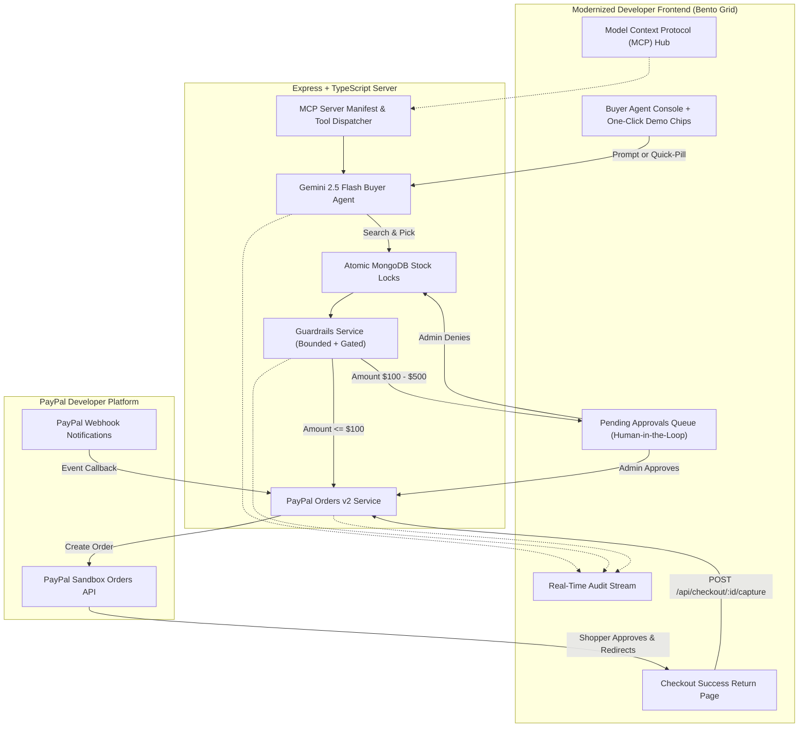

# Agentic Commerce — Studio Loom (PayPal AI Hackathon)

Studio Loom is an autonomous, agent-ready commerce storefront built for the **PayPal AI Hackathon**. A shopper expresses what they want in conversational natural language; a Gemini-powered AI buyer agent parses the shopper's intent, queries the catalog, selects the best matching item with explainable reasoning, verifies stock atomically, applies spending guardrails, and issues a **PayPal Orders v2 Checkout Order**. Every step is documented in an immutable audit trail.

[](LICENSE)
[](http://localhost:5000/api/mcp/manifest)
[](https://developer.paypal.com/docs/api/orders/v2/)

---

## Why Agentic Commerce Needs Guardrails

Agentic commerce demands more than a simple search interface. Studio Loom makes the end-to-end purchasing path safe, auditable, and resilient:

- **Agent-Readable Catalog & MCP Tools:** Standardized schema exposing product specifications, live stock levels, and merchant attribution via standard Model Context Protocol (MCP) endpoints for external agents (Claude Desktop, Cursor, OpenAI Swarm).
- **Atomic Stock Reservation:** Optimistic database locks that guarantee concurrent agent requests cannot oversell limited inventory.
- **Autonomous Spending Guardrails:** Configurable rules (e.g., maximum transaction limits and human-in-the-loop approval gates) before any payment order is generated:
  - `<= $100`: Auto-proceeds to PayPal Orders v2 link generation.
  - `$100 - $500`: Reserved atomically and held in the **Human-in-the-Loop Review Queue** for store manager approval.
  - `> $500`: Rejected by the hard safety cap with immediate stock release.
- **Resilient PayPal Integration:** OAuth 2.0 client credential caching, PayPal Orders v2 API with auto-retry, webhook verification, dedicated post-checkout return capture (`/checkout/success`), and automated inventory release upon payment cancellation (`/checkout/cancel`).
- **Explainable Audit Trail:** Full chronological telemetry stream showing AI intent extraction, catalog ranking, atomic stock reservation, guardrail evaluations, and PayPal payment states.

---

## Architecture Flow



---

## Interactive Demo Scenarios (One-Click Testing)

In the frontend Agent Console, click any pre-configured scenario chip to test edge cases instantly:

1. ⚡ **Happy Path ($55):** `"Black hoodie under $60"` &rarr; Autonomous intent parsing &rarr; Atomic lock &rarr; PayPal order created immediately with payment button.
2. 🛡️ **Approval Gate ($135):** `"Minimalist leather sneakers"` &rarr; Stock reserved &rarr; Held in the **Approvals Queue** for store manager authorization &rarr; Manager clicks **[Approve & Issue PayPal Link]**.
3. 🛑 **Hard Cap Rejection ($600):** `"Luxury designer tuxedo under $600"` &rarr; Guardrail triggers hard rejection &rarr; Stock instantly restored to catalog &rarr; Telemetry logged.
4. 📦 **Zero-Stock Recovery:** Test out-of-stock recovery by setting an item's stock to 0 in the **Catalog Inventory** tab and querying for it.

---

## Tech Stack

- **Frontend:** React 18, TypeScript, Vite, Tailwind CSS (Modern Obsidian & Bento Grid Developer Theme)
- **Backend:** Node.js, Express, TypeScript, Mongoose, MongoDB Atlas
- **AI / LLM:** Google Gemini structured JSON output (`gemini-2.5-flash` / `gemini-1.5-flash`)
- **Protocol:** Model Context Protocol (MCP) server manifest (`v2024-11-05`)
- **Payments:** PayPal Developer Platform (Sandbox Orders v2 REST API & Webhooks)

---

## Local Setup & Quickstart

### 1. Clone & Install
```bash
git clone <your-repo-url>
cd agentic-catalog
npm install
```

### 2. Configure Environment Variables
Create `server/.env`:
```env
PORT=5000
NODE_ENV=development
CLIENT_URL=http://localhost:5173

MONGODB_URI=mongodb+srv://<user>:<pass>@cluster.mongodb.net/agentic-catalog-paypal?retryWrites=true&w=majority

# PayPal Sandbox (developer.paypal.com > Apps & Credentials)
PAYPAL_CLIENT_ID=your_sandbox_client_id
PAYPAL_CLIENT_SECRET=your_sandbox_client_secret
PAYPAL_ENVIRONMENT=sandbox
PAYPAL_WEBHOOK_ID=your_webhook_id

# AI Agent (Google Gemini)
LLM_API_KEY=your_gemini_api_key
LLM_PROVIDER=gemini
LLM_MODEL=gemini-2.5-flash

# Guardrails (in USD)
MAX_ORDER_VALUE=500
APPROVAL_THRESHOLD=100
```

Create `client/.env`:
```env
VITE_API_BASE_URL=http://localhost:5000/api
```

### 3. Seed Catalog
```bash
npm run seed
```

### 4. Run Development Servers
```bash
npm run dev
```
- Frontend: `http://localhost:5173`
- Backend: `http://localhost:5000`

---

## Model Context Protocol (MCP) Integration

Studio Loom exposes a full Model Context Protocol (MCP) server. External AI agents (such as **Claude Desktop** or **Cursor**) can connect directly by adding this to their `claude_desktop_config.json`:

```json
{
  "mcpServers": {
    "studio-loom-commerce": {
      "command": "npx",
      "args": ["-y", "@modelcontextprotocol/server-fetch", "http://localhost:5000/api/mcp"]
    }
  }
}
```

Registered MCP Tools:
- `search_catalog`: Search clothes by keywords, category, and budget.
- `get_product_details`: Query live stock levels and SKU attributes.
- `create_guarded_checkout`: Atomically reserve stock and enforce spending guardrails.
- `run_gemini_buyer_agent`: End-to-end conversational agent execution.
- `inspect_audit_trail`: Audit trail verification.
- `manage_pending_approval`: Human-in-the-Loop queue management.

---

## API Endpoints

| Method | Path | Description |
| :--- | :--- | :--- |
| `GET` | `/api/health` | Service health status |
| `GET` | `/api/catalog` | List all catalog products |
| `GET` | `/api/catalog/search?q=&maxPrice=` | Search items with query and budget filter |
| `PATCH` | `/api/catalog/:id` | Update price or stock (demo lever for testing) |
| `POST` | `/api/checkout/:productId` | Reserve stock, check guardrails & create PayPal order |
| `GET` | `/api/checkout/:orderId` | Fetch order details and payment links |
| `POST` | `/api/checkout/:orderId/capture` | Capture PayPal payment upon approval redirect |
| `GET` | `/api/checkout/pending` | List orders held in Human-in-the-Loop review queue |
| `POST` | `/api/checkout/:orderId/approve` | Store manager approves order & generates PayPal link |
| `POST` | `/api/checkout/:orderId/deny` | Store manager denies order & releases reserved stock |
| `POST` | `/api/agent/buy` | Execute autonomous AI agent with `{ want, customerName }` |
| `GET` | `/api/audit?orderId=` | Query immutable decision audit logs |
| `GET` | `/api/mcp/manifest` | Get Model Context Protocol (MCP) server manifest |
| `POST` | `/api/mcp/tools/:toolName` | Directly execute an MCP tool |
| `POST` | `/api/webhooks/paypal` | Receive PayPal event notifications |

---

## License

This project is licensed under the [MIT License](LICENSE).
